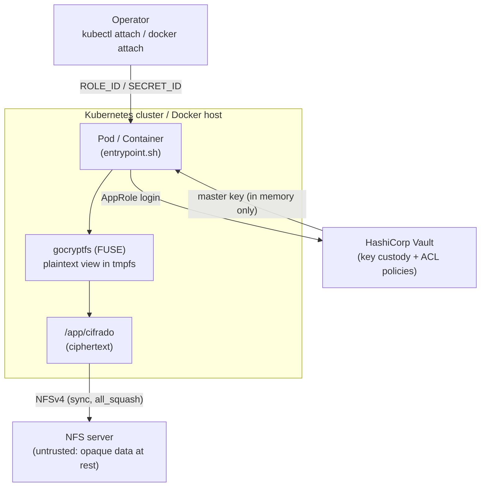

# Zero-Trust Encrypted Storage for Containers

Design, implementation and empirical evaluation of an architecture for **transparent execution of containers on encrypted filesystems**, validated both in isolated local environments (Docker) and in orchestrated distributed clusters (Kubernetes).

The stack integrates, in a modular way:

* **NFSv4** — centralized network storage (treated as an *untrusted* layer: data at rest is always opaque)
* **gocryptfs** — portable per-file encryption in user space (FBE over FUSE), AES-GCM-256 / XChaCha20-Poly1305
* **HashiCorp Vault** — centralized secret management with automated key injection via AppRole auth + least-privilege ACL policies


## Why this project

Docker/Kubernetes offer no native, transparent, fine-grained mechanism to encrypt/decrypt data *on the fly* at container level without operational friction. The hard part is injecting decryption keys automatically and securely into ephemeral containers, while keeping virtual mounts isolated from a potentially compromised host administrator — under a **Zero-Trust** model where the attacker is assumed to be already inside the execution environment.

## Architecture



Key design properties:

* **Decryption delegated to the container** — the host administrator only ever sees ciphertext.
* **Keys live in RAM only** — passed via stdin, then explicitly `unset`; nothing persists on disk.
* **Least privilege** — Vault policy grants `read` on a single KV path; NFS export uses `all_squash` to a dedicated UID (1001).
* **Key discarded after mount** — gocryptfs only needs the master key to establish the FUSE mount; the cryptographic material is purged right after, shrinking the attack surface.
* **Access revoked instantly** — if the Pod is destroyed or evicted, the next start requires human re-authorization (deliberate design decision: automated cluster secrets would be exposed on the host under the threat model).

## Repository structure

```
.
├── docker/
│   ├── poc/                # Main PoC: NFS + gocryptfs + Vault (Docker)
│   ├── baseline/           # Scenario 1: clean container (local fs, no encryption)
│   ├── gocryptfs-local/    # Scenario 3: local gocryptfs only
│   └── nfs-plain/          # Scenario 4: plain NFS only
├── k8s/
│   └── deployment.yml      # K8s Deployment (NFS volume + /dev/fuse via device plugin)
├── nfs/
│   └── exports.example     # Hardened NFSv4 export (sync, all_squash, no_subtree_check)
├── vault/
│   └── gocryptfs-policy.hcl  # Least-privilege Vault ACL policy
├── benchmarks/
    └── benchmark.sh        # Sequential + random I/O workload (4GB file / 10k files)


```

## Quick start (Docker PoC)

```bash
cp .env.example .env   # set NFS_SERVER and VAULT_ADDR
docker compose -f docker/poc/docker-compose.yml up -d --build
docker attach poc-cifrado   # enter ROLE_ID / SECRET_ID interactively

```

Prerequisites: an NFSv4 server exporting a gocryptfs-initialized directory, and a Vault server with an AppRole + KV secret at `secret/gocryptfs`.

## Quick start (Kubernetes PoC)

Requires a device plugin exposing `/dev/fuse` to pods (e.g. [smarter-device-manager](https://github.com/smarter-project/smarter-device-manager), applied first), then:

```bash
kubectl apply -f k8s/deployment.yml
kubectl attach deploy/app-cifrado   # enter Vault AppRole credentials

```

## Evaluation — key results

Workload: sequential read/write of a single 4 GB file + random read/write of 10,000 small files (4 KB), 5 iterations per scenario, caches dropped between runs. Network context: 15.3 Gbps bandwidth, 0.524 ms RTT — **well above** every storage result, so no bottleneck is attributable to physical network capacity.

| Scenario | Seq. write (MB/s) | Seq. read (MB/s) | Random write 10k files (s) |
| --- | --- | --- | --- |
| 1. Baseline (local fs) | 342.4 ± 12.2 | 528.6 | 90.64 |
| 3. gocryptfs (local) | 300.8 ± 18.0 | 451.6 | 94.21 (+3.9%) |
| 4. NFS (plain) | 296.4 ± 16.4 | 373.8 | 164.96 (+82.0%) |
| 2. Full system (NFS+gocryptfs) | 269.2 ± 10.4 | 225.4 (−57%) | 232.12 (+156%) |
| Full system on Kubernetes | 258.2 ± 10.9 | 195.2 | 253.71 |

**Root cause — transaction collapse, not cryptography:** measured with `nfsstat`, the 10k-file write generates **60,012 RPC calls on plain NFS vs 190,239 with the full stack (3.2×)**, with `getattr` exploding from 48,197 to 155,859 calls. `nfsiostat` at peak stress: useful writes drop from 145.5 ops/s to 39.5 ops/s while RTT grows from 2.43 ms to 7.29 ms — and the RPC backlog stays at 0, proving the bottleneck is the **synchronous FUSE user-space layer** serializing metadata operations, not the kernel network path. gocryptfs alone costs only ~4–15%: encryption is cheap, *synchronous metadata chatter over NFS* is expensive.

## Security model & known limitations

Mitigated:

* Host admin sees only ciphertext on disk and on the wire.
* Keys never persist: stdin → mount → purge from memory.
* Least-privilege everywhere: single-path Vault ACL, squashed NFS UID, non-root app user, capabilities dropped except `SYS_ADMIN`, AppArmor profile unconfined only where FUSE requires it.

Not mitigated:

* A **root attacker on the host** can still sniff plaintext I/O (strace on the FUSE process, `/proc/[PID]/fd` inspection, RAM dumps, `nsenter`). User-space FUSE cannot defend against a malicious host kernel — this is structural.
* FUSE metadata leakage (file sizes, count, timestamps).

Future work identified: **Kata Containers**, **Confidential Containers (CoCo)** and **SCONE** — moving from container-level to VM/hardware-enclave isolation so that even a compromised host cannot observe data in use.

## Tech stack

`Kubernetes` `Docker` `gocryptfs` `FUSE` `NFSv4` `HashiCorp Vault (AppRole, KV-v2)` `Proxmox VE` `VXLAN overlay` `Tailscale` `OpenWrt` `nfsstat` `nfsiostat` `iperf3` `Bash` `Linux (Ubuntu 24.04 / Debian 12)`

## Author

Christian David León Ilaño — [@chrisliel1](https://github.com/chrisliel1)